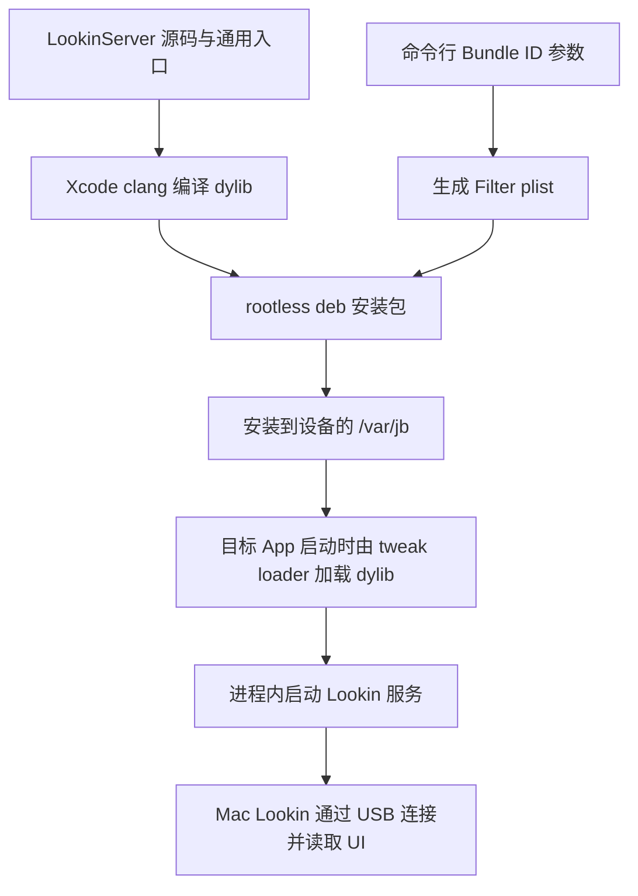

# LookinServer 注入指南

本文介绍如何将通用 `LookinInject.dylib` 加载到目标 App，并使用 Mac 上的 Lookin 查看 UI。所有 App ID、设备 ID 和连接地址均为占位符，使用前请替换为自己的配置。

## rootless 与 RootHide

本次增加的是 **rootless 构建和打包入口**。常见的 rootless 包布局将越狱文件安装到 `/var/jb` 下，包的 `Architecture` 使用 `iphoneos-arm64`。本项目遵循这套约定，详见 [Theos rootless 文档](https://theos.dev/docs/rootless)。

`rootless` 描述的是安装布局，并不表示不能使用 root 权限。安装包仍需由包管理器或具有相应权限的命令安装。

RootHide 使用随机位置的 jbroot，并有自己的库加载、路径转换和 bootstrap 规则，详见 [RootHide 官方开发文档](https://github.com/roothide/Developer/blob/main/roothide.md)。当前脚本没有 RootHide 专用打包、路径转换或验证流程；本指南的 `/var/jb` 命令与 deb 不作为 RootHide 安装指南。

为什么新增这条路径：

- 原有入口依赖 MonkeyDev；新脚本直接调用 Xcode clang，并使用 Python 标准库生成 deb，减少 Mac 端构建依赖。
- 原有包模板使用 `/Library/...` 和 `iphoneos-arm`，新包使用 rootless 所需的安装前缀与包架构。
- 对已有 tweak 注入环境的设备，可以由加载器在 App 启动时加载 dylib，直接使用已经安装的目标 App。
- 目标 App 通过 Filter 配置选择，切换或增加 App 无需修改注入入口源码。

## 注入原理

本项目负责生成运行在目标 App 进程里的 LookinServer 动态库。`build_rootless.py` 在 Mac 上完成编译与打包；实际加载动态库的是设备上的注入环境。



### 1. 编译与选择 App

脚本编译 `EntryPointFile.m` 和仓库内的 LookinServer Objective-C 源码，链接系统 Foundation、UIKit、QuartzCore 与 CoreGraphics，输出 `LookinInject.dylib`。库使用 `@rpath/LookinInject.dylib` 作为 install name，并进行 ad-hoc 签名。

`--bundle-id` 不会改变 dylib 的 App 逻辑，只用于生成同名 plist 中的 `Filter.Bundles`。例如：

```xml
<dict>
    <key>Filter</key>
    <dict>
        <key>Bundles</key>
        <array>
            <string>com.example.App</string>
        </array>
    </dict>
</dict>
```

设备上的 ElleKit 加载器按 Filter 匹配进程并加载动态库。它提供的兼容目录将 `Library/MobileSubstrate/DynamicLibraries` 指向实际 tweak 目录，见 [ElleKit 打包配置](https://github.com/tealbathingsuit/ellekit/blob/main/Makefile) 和 [注入器实现](https://github.com/tealbathingsuit/ellekit/blob/main/injector/injector.c)。

### 2. 进程内初始化

dylib 加载后，LookinServer 的 `+load` 注册 App 生命周期事件；`EntryPointFile.m` 的 constructor 再将初始化工作派发到主线程，并调用 `startIfNeeded`。这同时处理正常启动和向已经处于前台的 App 加载 dylib 的情况。

App 处于活动状态时，连接管理器查找可用端口并监听。当前真机端口范围是 `127.0.0.1:47175–47179`，定义在 `LookinDefines.h`。服务监听成功后发出就绪通知；提示还会检查前台窗口是否可用，每个进程只显示一次。

成功提示使用现有窗口中的非交互视图，不创建新的 key window，不 present 模态控制器，约 3 秒后自动移除。关闭提示只影响这层 UI，不会关闭服务。

### 3. Mac 读取 UI

Mac 的 Lookin 通过 USB 连接设备上的 LookinServer，由服务处理视图层级、图层和属性请求。USB 连接使用仓库内的 Peertalk 协议实现；本指南中的 SSH 只用于传文件和安装包，不参与 Lookin 的 UI 数据传输。

rootless tweak 路径在进程运行时加载动态库，无需向目标 App 的 Mach-O 文件写入新的加载命令。TrollFools 等工具则有各自的注入与持久化方式，应按工具文档操作。

## 环境准备

Mac 端：

- Python 3。
- 完整 Xcode，并选中其开发者目录；仅安装 Command Line Tools 不足以提供 iPhoneOS SDK。
- [Lookin Mac 客户端](https://lookin.work/)。

rootless deb 路径的设备端：

- 当前已经进入可用的越狱环境，并采用 `/var/jb` 布局。
- 已安装并启用 [ElleKit](https://github.com/tealbathingsuit/ellekit)；首次安装或更新后，按设备包管理器或越狱工具要求重新加载注入环境。
- 目标 App 已安装，且允许加载 tweak。
- USB 连接 Mac，设备解锁，并完成“信任此电脑”配对。

不需要安装 Frida。使用设备文件管理器和包管理器安装 deb 时，也不需要 SSH；仅下面的命令行安装示例使用 OpenSSH。

检查 Xcode SDK：

```bash
xcrun --sdk iphoneos --show-sdk-path
```

如果找不到 SDK，在 Xcode 设置中选择 Command Line Tools，或将开发者目录切换到自己的 Xcode 安装路径。

## 构建 dylib 或安装包

命令均在仓库根目录执行。

### 仅构建通用 dylib

```bash
python3 scripts/build_rootless.py
```

默认生成：

```text
build/rootless/
├── LookinInject.dylib
└── build-info.json
```

此模式不指定 App，交给外部注入工具使用。需要较低的部署版本时可以传入 `--min-ios 13.6`；脚本允许的最低版本为 13.0，实际可用性还取决于设备与注入工具。

### 生成 rootless / ElleKit 安装包

```bash
python3 scripts/build_rootless.py --bundle-id com.example.App
```

生成的额外文件是 `LookinInject.plist` 和 `LookinInject.deb`。包信息如下：

| 项目 | 内容 |
| --- | --- |
| Package ID | `com.isylar.lookininject` |
| 默认版本 | `0.2.0` |
| 包架构 | `iphoneos-arm64` |
| 默认 Mach-O 架构 | `arm64` |
| 依赖 | `ellekit` 和不低于 `--min-ios` 的系统固件 |
| 安装位置 | `/var/jb/Library/MobileSubstrate/DynamicLibraries/LookinInject.dylib` 与同名 `.plist` |

包架构是包管理器的标识，与 dylib 的 Mach-O 架构是两个概念。通常的第三方 App 使用默认 `arm64`；只有明确需要时才增加 `--arch arm64e`。rootless 包要求 `--min-ios` 至少为 15.0，这个下限不代表所有 iOS 15 及以上设备都支持越狱或本注入方式。

查询目标 App 的 Bundle ID，可以在 Mac 安装可选工具并列出设备 App：

```bash
brew install libimobiledevice ideviceinstaller
idevice_id -l
ideviceinstaller -u DEVICE_UDID list
```

将 `DEVICE_UDID` 换为自己的设备 ID，从列表中找到目标 App 的真实 Bundle ID。显示名称与 Bundle ID 不一定相同。

## 安装与连接

### 方式一：设备上安装

1. 将 `LookinInject.deb` 传到设备。
2. 使用设备上能够安装本地 deb 并处理依赖的包管理器或文件管理器打开该包。
3. 确认 ElleKit 已安装且注入环境已启用。
4. 完全退出目标 App，再重新打开。切到后台再返回不会创建新进程，不能代替这一步。
5. 在 Mac 上打开 Lookin，通过 USB 选择对应设备和 App。

只安装或更新本项目的包后，重新启动目标 App 即可加载新库；如果 ElleKit 尚未生效，应先按其安装流程重新加载注入环境。

### 方式二：通过 SSH 安装

设备需安装 OpenSSH。下面以同一网络连接为例，替换 `DEVICE_IP`，使用自己的设备账户与密码或已配置的 SSH 密钥：

```bash
scp build/rootless/LookinInject.deb mobile@DEVICE_IP:/var/mobile/LookinInject.deb
ssh -t mobile@DEVICE_IP 'sudo /var/jb/usr/bin/dpkg -i /var/mobile/LookinInject.deb'
```

`dpkg -i` 不会下载缺失依赖，请先在设备包管理器中安装 ElleKit。命令不需要修改目标 App，也不要求提供 App 签名证书。

如果使用 USB SSH，可以在 Mac 上安装 `iproxy` 所在的工具包，另开终端保持转发运行：

```bash
brew install libusbmuxd
iproxy -u DEVICE_UDID 2222:22
```

在另一个终端执行：

```bash
scp -P 2222 build/rootless/LookinInject.deb mobile@127.0.0.1:/var/mobile/LookinInject.deb
ssh -t -p 2222 mobile@127.0.0.1 'sudo /var/jb/usr/bin/dpkg -i /var/mobile/LookinInject.deb'
```

端口转发只用于上述 SSH 操作；Lookin 自己处理 USB 连接，不需要这个转发。完成安装后可结束 `iproxy`。

### 验证结果

1. 重新打开目标 App，在前台等待顶部“Lookin 已注入”提示。使用 `--no-notice` 构建时不会显示。
2. Mac 的 Lookin 能列出对应设备与 App。
3. 连接后能读到窗口、视图层级与属性；切换页面后刷新，能读取当前 UI。

提示出现说明进程内服务已就绪，最终以 Mac 上能成功读取 UI 为连接验证结果。

## 更新、切换 App 与卸载

### 更新同一套配置

重新构建并安装新的 deb，然后完全退出并重新打开目标 App。可以用 `--package-version` 指定新版本：

```bash
python3 scripts/build_rootless.py \
  --bundle-id com.example.App \
  --package-version 0.2.1
```

### 同时启用多个 App

```bash
python3 scripts/build_rootless.py \
  --bundle-id com.example.FirstApp \
  --bundle-id com.example.SecondApp
```

所有生成的 deb 使用相同 Package ID。后安装的包会替换已有库和 Filter，不会追加旧 App 列表；每次构建请传入全部需要启用的 App。修改 Filter 后，应重新启动受影响的 App，已加载的 dylib 不会从运行中的进程自动卸载。

需要保留多套构建配置时使用不同的 `--output-dir`。仅构建 dylib 会清理同一输出目录之前生成的 plist 和 deb，但不会修改设备上已经安装的包。

### 卸载

在设备包管理器中卸载 `LookinInject`，或在设备 SSH 会话中执行：

```bash
sudo /var/jb/usr/bin/dpkg -r com.isylar.lookininject
```

然后完全退出并重新打开曾注入的 App。卸载包只移除本项目的注入文件，不卸载 ElleKit 或目标 App。

## 使用 TrollFools 等工具注入 dylib

在支持对应工具的设备环境中，先构建通用 dylib：

```bash
python3 scripts/build_rootless.py --min-ios 13.6 --output-dir build/dylib
```

将 `build/dylib/LookinInject.dylib` 导入注入工具，选择目标 App 并执行注入，再完全退出并重新打开 App，使用 Mac Lookin 连接。这个流程不使用脚本生成的 Filter 或 rootless deb。

[TrollFools 官方仓库](https://github.com/Lessica/TrollFools) 说明了其系统支持范围和注入方式；安装、撤销注入及 App 更新后的处理应以所用工具的文档为准。不能把本项目的最低部署版本当作该工具的系统支持范围。

原有 MonkeyDev 工程也可以生成 dylib；具体入口见 [README](../README.md#原有-monkeydev-流程)。

## 常见问题

| 现象 | 检查方式 |
| --- | --- |
| 编译时找不到 iPhoneOS SDK | 确认安装完整 Xcode，并正确选择开发者目录 |
| deb 安装失败，提示缺少 `ellekit` | 先用设备包管理器安装 ElleKit，再安装本项目的包 |
| 提示包架构或安装目录不兼容 | 确认使用本指南对应的 rootless 环境；当前包没有 RootHide 专用适配 |
| 安装成功，但首次重开 App 没有提示 | 检查 Bundle ID、Filter、tweak 注入开关、ElleKit 是否生效，以及是否使用了 `--no-notice` |
| 切到后台再回来，没有再次提示 | 每个进程只显示一次，这是预期行为 |
| 提示已出现，但 Mac Lookin 找不到 App | 检查 USB 数据连接与配对，保持设备解锁、App 在前台，刷新客户端 App 列表并确认客户端兼容性 |
| 改了 Bundle ID，旧 App 仍能连接 | 旧进程可能已加载 dylib；完全退出并重新打开旧 App |

查看设备上的包与配置，可在 SSH 会话中执行：

```bash
/var/jb/usr/bin/dpkg-query -W com.isylar.lookininject ellekit
cat /var/jb/Library/MobileSubstrate/DynamicLibraries/LookinInject.plist
ls -l /var/jb/Library/MobileSubstrate/DynamicLibraries/LookinInject.*
```

本项目主要面向 UIKit 的视图与图层检查，不承诺还原 SwiftUI 的声明式结构或 Web 页面的 DOM。当前验证包括 iPhone / iPad 模拟器、iPad 上的 iPhone 兼容模式、向前台进程加载 dylib，以及 rootless / ElleKit iPad 真机的提示与 UI 层级读取；这不代表已验证所有设备、系统和注入工具组合。
